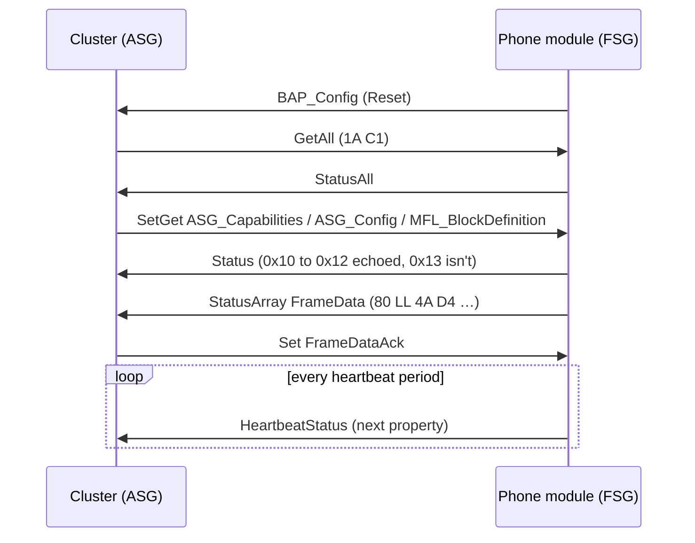

# Secondary Display (LSG 0x2B) Overview

The Secondary Display lets the phone module put text on the cluster: the phone name, signal and battery, call lists, incoming call pop-ups. The phone module builds whole screens of text. The cluster draws them.

## Who's who

The **phone module is the FSG** (it owns the content) and the **cluster is the ASG** (it displays it):

| CAN ID | Name | Direction |
|---|---|---|
| 0x66F | BAP_Telefon_04 | phone (FSG) → cluster |
| 0x67C | BAP_ASG_07 | cluster (ASG) → phone |

The phone module also reads the steering wheel buttons straight off plain CAN (0x5C1 `mMFL_Tasten`) to scroll its lists, rather than getting them over BAP. A press is `[key] 00 [counter] 60`, released with `00 00 [counter] 60` (keys logged in car):

| up | down | left | right | OK | back |
|---|---|---|---|---|---|
| `22` | `23` | `09` | `0A` | `28` | `29` |

On a bench, send the press once and release 100 ms later. Left and right change the cluster page. The cluster needed no coding for this LSG. In a car the **gateway** does.

**Before you emulate one:**

- Do it on a bench, see [Connect and Listen Safely](../../platforms/connect-and-listen.md#on-a-bench).
- A MIB2 PQ already sends 0x66F itself, so a car without a phone module can still have that ID in use.
- On the bench an emulated phone made the cluster's ACC main page **disappear**, in two separate runs.

The phone's BAP_Config is `03 00 2B 00 03 01` (BAP 3.0, DF 3.1), and its FunctionList is `78 01 FF 00 00 00 00 00`: 0x01–0x04, 0x0F, and 0x10–0x17. There's no FSG-Setup (0x0E) on this one.

## Functions

Tested with cluster, logged in car. The same table is in the [catalogue](../../catalogue/lsg2B-uhv_secondarydisplay-df3.1.md):

| FCT | Name | Class | Cluster sends | Phone sends | Size |
|---|---|---|---|---|---|
| 0x01 | GetAll | Cache | GetAll | StatusAll | – |
| 0x02 | BAP_Config | Property | Get | Reset, Status, Heartbeat | 6 |
| 0x03 | FunctionList | Property | Get | Status, Heartbeat | 8 |
| 0x04 | HeartBeat | Property | Get | Status, Heartbeat | 1 |
| 0x0F | FSG_OperationState | Property | Get | Status, Heartbeat | 1 |
| 0x10 | ASG_Capabilities | Property | Get, SetGet | Status, Heartbeat | 2 |
| 0x11 | ASG_Config | Property | Get, SetGet | Status, Heartbeat | 2 |
| 0x12 | MFL_BlockDefinition | Property | Get, SetGet | Status, Heartbeat | 8 |
| 0x13 | FrameStatus | Property | Get, SetGet | Status, Heartbeat | 6 |
| 0x14 | FrameData | **Array** | GetArray | StatusArray, ChangedArray | up to 685 |
| 0x15 | FrameDataAck | Property | **Set** | Status, Heartbeat | 1 |
| 0x16 | ScrollBar | Property | Get | Status, Heartbeat | 4 |
| 0x17 | LsgStatus | Property | **Set** | Status, Heartbeat | 1 |

0x01, 0x03, 0x12 and 0x14 are segmented from the phone, the rest are single frames. The cluster's SetGet on 0x12 is segmented too (logged in car).

A pattern worth noticing: the cluster *describes itself* by SetGet'ing 0x10–0x13 into the phone, the phone *sends screens* on 0x14, and the cluster *confirms* with a plain Set on 0x15 and 0x17.

## The properties the cluster writes

**0x10 ASG_Capabilities**: `[display size][visible elements]`. Size 0 is small, 1 medium, 2 large. The phone treats large as medium (untested).

**0x11 ASG_Config**: `[major][minor]`, the version of the display protocol the cluster speaks, 1.0 or 1.1. Anything else and the phone falls back to 1.1 (untested).

**0x12 MFL_BlockDefinition**: 8 bytes, one key-block per byte. These say which steering wheel keys the cluster is handing over (up/down, left/right, OK, back, rotary…). Values are on the [Constants and Definitions](constants.md) page.

**0x13 FrameStatus**: 6 bytes:

```plaintext
[frame ID][relative priority][focused frame ID][MFL blocks][ASG response][FSG request]
```

This is the handshake over which screen is showing. When the cluster writes it, FSG request must be `0xFF` (no request). When the phone reports it, the phone uses FSG request to ask for things, for example "make my frame visible" for an incoming call, and the cluster answers in ASG response (on, off, queued…).

**0x13 isn't echoed.** On an emulated cluster an echo made the page close again, and these answers opened it. They're from the car log:

| Cluster writes | Phone answers | Meaning |
|---|---|---|
| `00 00 FF 00 00 FF` | `00 00 FF 00 00 00` | connect |
| `01 00 FF 00 00 FF` | `FF 00 00 00 00 00` | frame 1 made invisible |
| `FE 00 00 00 03 FF` | `07 00 00 00 03 02` | page wanted: frame 7, accepted |
| `07 00 00 07 01 FF` | `07 00 07 07 01 01` | frame 7 made visible, now has the focus |
| `07 00 00 00 00 FF` | `07 00 00 00 00 00` | frame 7 made invisible |
| `FF 00 00 00 00 FF` | `FF 00 00 00 00 00` | page left |

Byte 3 is `07` while a frame is visible. With three blocks in 0x12 (`02 07 08`) I think it's a bitmask of them, that's **inferred**. Sending `07`, `01` or `00` made no difference on an emulated cluster.

**0x15 FrameDataAck**: the cluster Sets it with the ID of the frame it received. That isn't proof it's on screen: frame 1 was acked after the cluster had made it invisible, and frame 7 before its page was opened (logged in car). The Set gets no Status back. **0x17 LsgStatus**: the cluster Sets it to 0 or 1, meaning "I'm alive and showing you" or not. No Status comes back straight away here either.

## FrameData, the screen itself

FrameData is an **array** (see [Arrays](../../protocol/arrays.md)). In the car the phone pushes each screen as a StatusArray without being asked, and the cluster confirms it with a Set on 0x15. There's no GetArray on 0x2B in that log at all.

If the page opens and the cluster has no data for the frame, it asks (tested with cluster, emulated): `80 04 1A D4 07 07 00 04`, which is `[frame ID]` and an array header, segmented. An empty answer of `80 06 4A D4 07 00 00 47 | C0 00 00` is accepted and acked, and the page is blank. With no answer, or a single frame, it asks five times 500 ms apart and leaves the page.

The phone sends partial updates too, also with opcode 4 and the same 3-byte prefix: mode `44` carries only attributes and `41` only names (logged in car). `start` is the first cell in the update. This moves the highlight down one line:

```plaintext
80 0E 4A D4 02 01 02 44 | C0 01 04 01 00 02 81 03 | C1 82 04 81
02          frame 2
01          list element on top
02          list down
44 01 04    transmitPos, attributes only, start 1, 4 cells
01 00   02 81   03 82   04 81        position, attributes
```

The cluster Set 0x15 to `02` 20 ms after the last frame, and the next update came 0.6 s later. A ScrollBar Status (`4A D6 …`) goes out with each of these updates.

The answer is laid out like this:

```plaintext
[frame ID][list element on top][list operation][array header (3 or 5 bytes)]
then for each cell:
[position][cell type][cell attributes][name length][name bytes…]
```

Which of type, attributes and name are present depends on the recordAddress in the array header (`7` = all three). The phone always sets transmitPos, so every cell starts with its position.

How the cluster draws each cell type I've only seen on the bench.

A real first screen, 42 bytes (logged in car):

```plaintext
01          frame 1
00          list element on top
00          no list operation
47 00 04    array header: transmitPos, name+type+attr, start 0, 4 elements
00 00 80 08 53 74 61 72 74 69 6E 67                pos 0, string, visible, "Starting"
01 00 80 0C 74 65 6C 65 70 68 6F 6E 65 2E 2E 2E    pos 1, "telephone..."
02 00 80 00                                        pos 2, empty
03 00 80 00                                        pos 3, empty
```

It's a StatusArray (opcode 4), so the header is `4A D4`, and it goes out segmented on 0x66F.

### Frame 7 on the cluster

Tested with cluster (emulated SW1104). The page title is *Telephone*.

| Cell | Where | Fits about |
|---|---|---|
| 0 | top, small | 15 digits, then "…" |
| 1 | middle, large | 9 digits, then "…". No icons, they draw as a box |
| 2, 3 | bottom, left and right | 8 digits each, then they overlap |
| 4 and up | not drawn | |

- Full screens and name-only (`41`) updates both changed the display, at every rate I tried up to 5 per second. Each one was acked.
- Attribute-only (`44`) updates had no visible effect on this frame.
- Cells you leave out keep their old text.
- Up, down, OK and back sent nothing to the phone on 0x67C.

### Cells and limits

A frame holds up to 12 cells, and longer ones go out in parts: `47 00 07` then `47 07 05` in the car. Phone numbers get cut to 32 characters (untested). Text is UTF-8, and icons are characters in the Unicode private use area (see [Icon Mappings](icons.md)).

## 0x16 ScrollBar

4 bytes, sent by the phone:

```plaintext
[frame ID][attributes][slider length][slider position]
```

## Start-up on the bus

This follows the normal [Session Lifecycle](../../protocol/session-lifecycle.md):



Only the phone heartbeats, the cluster just watches.

The same thing in the car (seconds, `>` phone, `<` cluster, segmented messages shown whole):

```plaintext
 0.624  > 0A C2  03 00 2B 00 03 01     BAP_Config, Reset
 0.683  < 1A C1                        GetAll
 0.696  > 4A C1  44 bytes              StatusAll, segmented
 0.834  < 2A D0  00 03                 ASG_Capabilities. The phone answers each one with Status
 0.881  < 2A D1  01 01                 ASG_Config
 0.933  < 2A D2  02 07 08 00 00 00 00 00   MFL_BlockDefinition, segmented on channel 1 (90 08 2A D2 …)
 0.983  < 2A D3  00 00 FF 00 00 FF     FrameStatus
 1.023  > 4A D3  00 00 FF 00 00 00
 1.032  < 0A D7  01                    LsgStatus
 4.772  > 4A D3  01 00 00 00 FF FF     the phone announces frame 1
 4.791  > 4A D4  42 bytes              FrameData, frame 1
 4.818  < 2A D3  01 00 FF 00 00 FF     during the transfer
 4.832  > 4A D3  FF 00 00 00 00 00
 4.971  < 0A D5  01                    FrameDataAck, frame 1
```

Screens can be sent before the page is open. Frame 7 went out in full at 20.731, 20.971 and 21.192, each acked, 40 s before the page was opened.

The phone also sends 0x17 `01` as a Status about every 5 s, and the cluster answers with a Set of `01`.

Opening the phone page later, where frame 7 is the phone's main page:

```plaintext
 < 2A D3  FE 00 00 00 03 FF     any frame, the cluster asks for it to be visible
 > 4A D3  07 00 00 00 03 02     frame 7, request accepted
 < 2A D3  07 00 00 07 01 FF     frame 7 made visible
 > 4A D3  07 00 07 07 01 01     frame 7 has the focus
```

The readings on the right use the [constants](constants.md#framestatus). The bytes are logged in car. Traces: [start-up](../../../Traces/PQ/LSG_0x2B_SecondaryDisplay_startup_Passat_B7.crtd), [opening the page and scrolling](../../../Traces/PQ/LSG_0x2B_SecondaryDisplay_page_Passat_B7.crtd).

Related: [Constants and Definitions](constants.md) · [Icon Mappings](icons.md) · [Arrays](../../protocol/arrays.md) · [LSG Index](../README.md)
