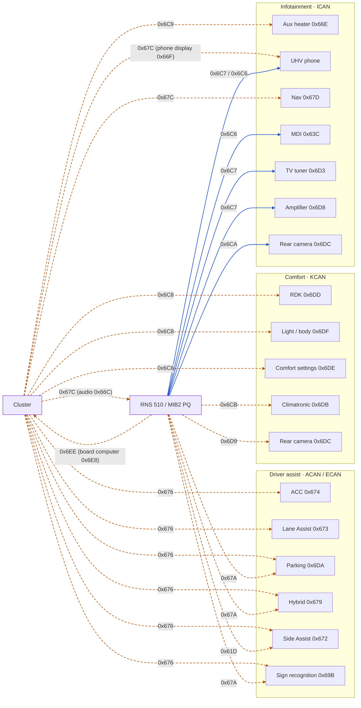

# PQ Network Map

A PQ car has two BAP displays: the cluster and the radio (RNS 510 or MIB2 PQ). Most of the modules they talk to are on other buses, and the gateway (J533) forwards whole frames by CAN ID. Bit rates are on [Connect and Listen Safely](connect-and-listen.md).

The radio plays both roles. It's the ASG for the phone, MDI, camera, climate and some driver assist. It's also an FSG for the cluster: when the cluster asks on 0x67C, the radio answers on 0x66C with the audio screen (LSG 0x31). A MIB2 PQ goes further and also answers the phone display (0x66F, LSG 0x2B) and navigation (0x67D, LSG 0x32) itself. The cluster is the same in reverse: an ASG for almost everything, and an FSG for the board computer (0x6E8), which the RNS midline asks for on 0x6EE.

## Where everything sits

Each box is a bus and the gateway is the hub. The IDs are what each module transmits. "ASG" is what a display asks on, "FSG" is what a module answers on.

```mermaid
flowchart TB
    GW{{"Gateway J533<br/>forwards whole frames by ID"}}

    subgraph KOMBI["Cluster bus · 500k"]
        direction TB
        KBI["Cluster (KBI)<br/>ASG 0x676 · 0x6C8 · 0x6C9 · 0x67C<br/>FSG 0x6E8 (board computer)"]
    end

    subgraph ICAN["ICAN · infotainment · 100k"]
        direction TB
        RNS["RNS 510 / MIB2 PQ<br/>ASG 0x6C5 · 0x6C6 · 0x6C7 · 0x6CA · 0x6B7<br/>ASG via gateway 0x67A · 0x6CB · 0x6D9 · 0x61D · 0x6EE<br/>FSG 0x66C (audio); MIB2 PQ also 0x66F · 0x67D"]
        UHV["UHV phone<br/>FSG 0x6D2 · 0x6D5 · 0x63B · 0x62C<br/>FSG 0x66F (to cluster)"]
        MDI["MDI box<br/>FSG 0x63C"]
        TV["TV tuner<br/>FSG 0x6D3"]
        DSP["Amplifier<br/>FSG 0x6D8"]
        NAV["Nav / compass<br/>FSG 0x67D"]
        SHZ["Aux heater<br/>FSG 0x66E"]
    end

    subgraph KCAN["KCAN · comfort · 100k"]
        direction TB
        CLIMA["Climatronic<br/>FSG 0x6DB"]
        CAM["Rear camera<br/>FSG 0x6DC"]
        BCM["Light / body<br/>FSG 0x6DF"]
        COMF["Comfort settings<br/>FSG 0x6DE"]
        RDK["RDK tyre pressure<br/>FSG 0x6DD (or on ECAN)"]
    end

    subgraph ACAN["ACAN · powertrain · 500k"]
        direction TB
        ACC["ACC<br/>FSG 0x674 (or on ECAN)"]
        HCA["Lane Assist<br/>FSG 0x673 (or on ECAN)"]
        OPS["Parking<br/>FSG 0x6DA · 0x678"]
        HYB["Hybrid<br/>FSG 0x679"]
    end

    subgraph ECAN["ECAN · extended · 500k"]
        direction TB
        SWA["Side Assist<br/>FSG 0x672"]
        VZA["Sign recognition<br/>FSG 0x69B"]
    end

    KOMBI <--> GW
    GW <--> ICAN
    GW <--> KCAN
    GW <--> ACAN
    GW <--> ECAN

    classDef asg fill:#dbeafe,stroke:#1d4ed8
    classDef both fill:#ede9fe,stroke:#6d28d9
    classDef gw fill:#fef3c7,stroke:#b45309
    class KBI,RNS both
    class GW gw
```

The camera can be on either side. On the KCAN the radio asks it on 0x6D9 through the gateway. With the camera on ICAN next to the radio, the pair is 0x6CA / 0x6DC and the gateway never sees it. ACC, Lane Assist and RDK are the same story: the gateway accepts them from either bus, whichever one the car has them on.

## Who asks whom

An arrow goes from the display (ASG) to the module (FSG), labelled with the ID the display asks on. Blue arrows stay on one bus; amber ones cross the gateway.

A few things stand out:

- **The UHV phone module answers two displays.** It sends the phone and phonebook to the radio (0x6D2, 0x6D5, 0x63B, 0x62C) and a separate secondary display to the cluster (0x66F, LSG 0x2B).
- **The gateway forwards some driver-assist traffic to the radio.** Parking, hybrid and VZA go to ICAN, and Side Assist too on later gateways. It also forwards the radio's requests (0x67A, 0x61D) the other way.
- **The cluster's requests on 0x6C9 go to ICAN only.** That's how it reaches the aux heater. It also asks LSG 0x17 (drive profile) and 0x22 (driver alert) there.
- **The radio's own modules never touch the gateway.** The phone, MDI, TV and amplifier all share ICAN with the radio.
- **In a MIB2 PQ car the cluster's phone page comes from the head unit.** The MIB2 PQ is itself the FSG for LSG 0x2B on 0x66F, as well as for audio (0x66C) and navigation (0x67D), so all three 0x67C pages come from it.

Related: [PQ CAN Channels](pq-can-channels.md) · [CAN ID Map](can-id-map.md) · [LSG Index](../lsg/README.md)
