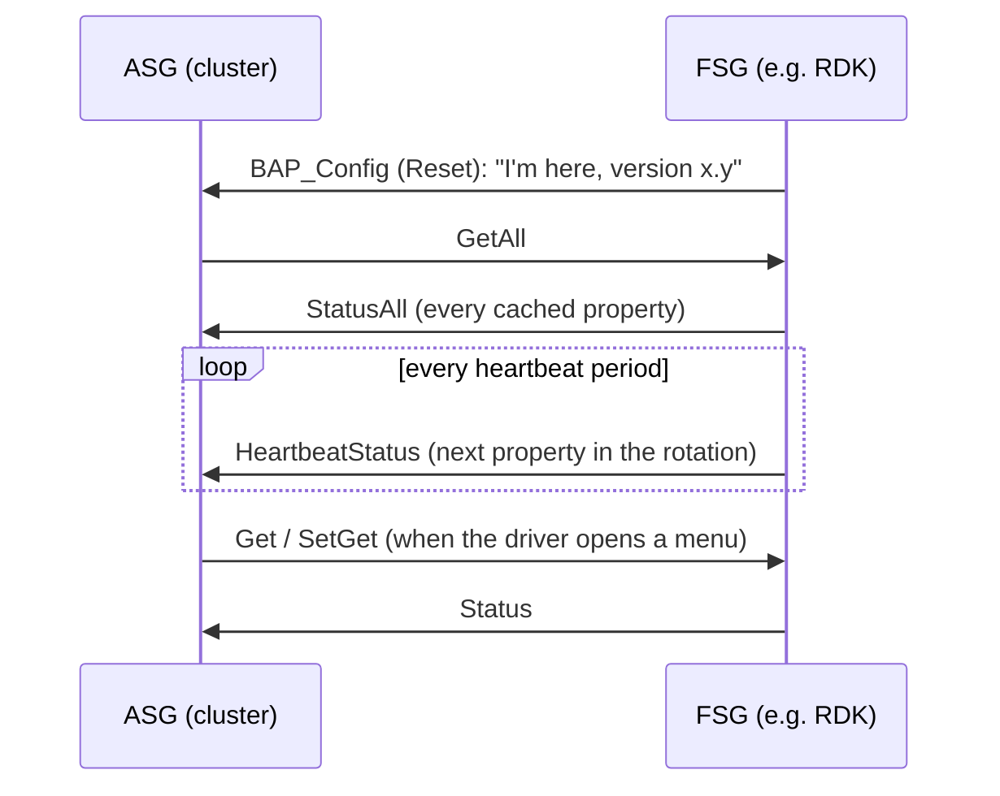

# Session Lifecycle

How an FSG and an ASG find each other, stay in sync, and notice when the other one disappears.

## Start-up

**The FSG** doesn't wait for anybody:

1. It sends its **BAP_Config** with the **Reset** opcode: "I've just (re)started, here's my version" (logged in car).
2. It goes straight to running and starts its heartbeat.

An ASG that asks before then gets the same bytes as a plain Status.

**The ASG** holds off on everything else until it has a BAP_Config:

1. It asks for BAP_Config (Get).
2. One arrives, as the answer or as an FSG's Reset.
3. It checks the protocol version. Until that passes, it makes no other requests to that LSG.
4. It throws away anything it had cached for that LSG.
5. It sends **GetAll**.

A later Reset, say because the FSG rebooted, starts the same cycle again.



On a real Passat, cluster and RDK (seconds):

```plaintext
572.103  0x6DD  01 C2 03 00 07 00 04 00   RDK: BAP_Config (Reset)
572.110  0x6C8  11 C1                     cluster: GetAll (LSG 0x07)
572.204  0x6DD  80 27 41 C1 03 00 07 00   RDK: StatusAll, 94 ms later
   …                                       5 continuation frames, 50 ms apart
```

After that the cluster doesn't ask for much. Across five drive captures it only sends:

- GetAll
- GetArray on 0x14 (wheel-size list)
- StartResult on 0x17 (wheel-size selection)
- Get BAP_Config, in logs where it's still looking for the module

It never polls the pressures. It just listens to the rotation.

## The heartbeat rotation

Some properties are *heartbeat* properties. Every heartbeat period (FCT 0x04, usually 1 s) the FSG sends the **next one** as HeartbeatStatus, going round in FCT order. Any other message the FSG sends restarts the timer, so a busy FSG heartbeats less.

On the RDK that's nine properties (0x02, 0x03, 0x04, 0x0D, 0x0E, 0x0F, 0x10, 0x11, 0x13), about a second apart. The rear view camera shows the pattern cleanly:

```plaintext
262.61  0x6DC  32 C2 03 01 0B 00 05 01   HB 0x02 BAP_Config
263.61         80 08 32 C3 78 07 C3 E0   HB 0x03 FunctionList (segmented)
264.60         32 C4 0A                  HB 0x04 HeartBeat
265.61         32 CD 10                  HB 0x0D
266.60         32 CE 00 01 0B 00 00 00   HB 0x0E FSG-Setup
267.61         32 CF 02                  HB 0x0F OperationState
268.61         32 D0 64                  HB 0x10
   …           0x11, 0x16, 0x17, 0x18, 0x19, 0x1A
275.61         32 C2 03 01 0B 00 05 01   and back to 0x02
```

The settings LSGs in the cluster menus do the same. A short capture of one only catches a slice of the rotation, so it looks misleadingly empty.

One thing that caught me out: settings LSGs also broadcast **scroll progress**. Scroll a menu option and you'll see Status updates tens of ms apart. The committed value is the last one before a pause.

## When the heartbeat stops

The ASG runs a watchdog per LSG. It only starts once a real heartbeat has arrived. Its timeout is a multiple of the FSG's announced heartbeat period. When it fires, the ASG:

1. marks everything it cached from that LSG as **invalid**
2. goes back to waiting for BAP_Config, and then GetAll

Nobody sends anything on the bus to say the connection dropped. From the outside you see Get BAP_Config, in bursts of five. When the FSG comes back with a Reset, GetAll follows. On the emulated cluster an FSG that only resumed its heartbeats got no GetAll: after one full rotation the cluster carried on with its SetGets.

With a 1 s heartbeat it took 5 s, on a MIB2 ([MIB2 Results](mib2.md#watchdog)) and on an emulated cluster with 0x2B (tested with cluster). On that cluster **any** message fed it. The link held with no heartbeats at all, as long as something else went out every few seconds. So frequent updates are safe, even when they hold off the rotation.

## Requests that go unanswered

- **GetArray** with no usable answer is asked again about every 500 ms (tested with cluster).
- **Get BAP_Config** to a module that isn't there goes out in bursts of five, 500 ms apart, with a pause of about 20 s between bursts (logged in car, the cluster looking for a wiper module).

A MIB2 sends most requests five times and then gives up (tested with cluster). A cluster doesn't on the RDK's GetArray, but it did on 0x2B's. The table is on [MIB2 Results](mib2.md#retries).

## What this means if you're emulating an FSG

The checklist I ended up with, the hard way:

1. Use the right BAP and DF version. A wrong BAP minor stores a fault in the cluster, see [Versions](versions.md#cluster).
1. Announce BAP_Config when you start (Reset), then start heartbeating straight away. Don't wait for a GetAll that might never come.
2. Answer GetAll with a proper StatusAll: every cached property, in FCT order, with length prefixes on the variable-length ones.
3. Keep the rotation going. Always send the slot's value, even if it's an empty variable-length value. The ASG notices gaps.
4. Answer every Get and SetGet with a Status, even when nothing changed.
5. Get the segmentation right for each function (see [Frames on the Wire](frames.md)). If you don't, all of the above looks broken.

Related: [Generic Functions](generic-functions.md) · [Opcodes and Function Classes](opcodes.md) · [Errors](errors.md) · [MIB2 Results](mib2.md)
